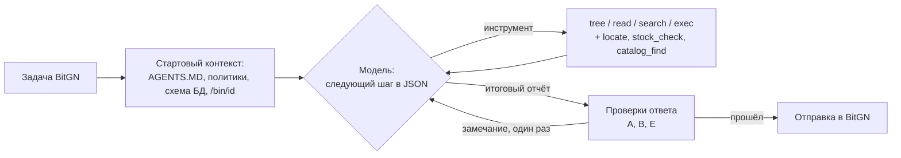

# BitGN ECOM agent

[](https://github.com/Umorz/bitgn-ecom-agent/actions/workflows/tests.yml)

LLM-агент для испытания [BitGN ECOM](https://bitgn.com/challenge/ecom) (операции интернет-магазина:
каталог, остатки, заказы, возвраты, платежи, политики доступа) и инструменты для его оценки:
серийные прогоны, деление тестового набора на анализ и отложенную часть, парные статистические
сравнения вариантов.

Главный вывод работы: **качество агента росло от точных проверок ответа перед отправкой,
а не от дополнительных инструментов и правил** - часть таких правок поднимала балл на dev
и одновременно снижала его на prod.

## Результат

| Набор | Агент | Балл |
|---|---|---|
| ECOM1 PROD (100 задач) | итоговая оболочка, среднее по 3 прогонам | **0.760** |
| ECOM1 PROD | лучший прогон | 78.9 / 100 - **30 место из 117** в [живой таблице](https://bitgn.com/l/ecom1-prod) (17.10.2026) |
| ECOM1 DEV (55 задач) | исходный пример BitGN на той же модели | 0.00 (модель не видела схему ответа) |

Модель - открытая Qwen через OpenAI-совместимый API. Выше в таблице в основном агенты на крупных
закрытых моделях.

## Как устроен агент



- **Шаг модели** - JSON по схеме (pydantic). Схема дублируется в промпте: самостоятельно развёрнутые
  OpenAI-совместимые серверы применяют `response_format` только как ограничение и не показывают схему
  модели - без этого исходный пример получал 0.
- **Инструменты предметной области** (`locate`, `stock_check`, `catalog_find`) сворачивают типовые
  цепочки поиска в один вызов и читают данные из файлов или SQL, смотря что доступно.
- **Проверки ответа** перед отправкой. Каждая срабатывает не больше раза за задачу и не правит ответ,
  а возвращает модели замечание:
  - **A, приватность**: в отказе по соображениям безопасности есть ссылки на записи других людей;
  - **B, формат**: задача требует ответ в определённом виде, а ответ длиннее или многострочный;
  - **E, названные объекты**: номер из текста задачи (SKU, магазин) есть в данных, но не процитирован.

## Эксперименты и методика

- **Наборы**: dev (55 задач, разбор провалов разрешён) и prod (100 задач). Prod разделён
  стратифицированно по видам задач на две половины: **analysis** (провалы разбираются, по ней
  проектируются правки) и **holdout** (провалы не разбираются, по ней проверяется перенос).
- **Повторы**: каждый вариант - 3 прогона на prod; варианты сравниваются **попарно по задачам**
  (бутстреп-интервал и перестановочный тест), финальное сравнение - чередующимися прогонами
  в одной сессии, чтобы исключить дрейф сервера.

**Переобучение на dev.** Правки, перенесённые из ранней оболочки под другую модель, добавлялись по
одной группе (по одному прогону на ступень). Dev рос, prod падал:

| Ступень | dev | prod |
|---|---|---|
| устойчивость + схема в промпте | 0.585 | 0.539 |
| **+ правки 12-15 (ступень B, оставлена)** | 0.664 | **0.579** |
| + правила и примеры, 3 группы | 0.662 → 0.775 | 0.545 → 0.501 → 0.544 |
| + все остальные правки | **0.848** | 0.532 |

**Варианты поверх ступени B** (prod - среднее по 3 прогонам):

| Вариант | dev | prod | prod holdout | Решение |
|---|---|---|---|---|
| ступень B | 0.679 | 0.610 | 0.541 | база |
| + инструменты (2 пары) | 0.675 | 0.620 | 0.572 | оставлено: столько же качества, шагов на 28% меньше |
| **+ проверки A+B** | 0.722 | **0.725** | 0.734 | оставлено (p = 0.004 в парном сравнении) |
| + D: состояние процесса | 0.700 | 0.615 | 0.582 | отклонено: нет пользы |
| + C: журнал доказательств | 0.771 | 0.664 | 0.607 | отклонено: вредно, holdout -0.127 |
| + SQL-инструмент query | 0.800 | 0.681 | 0.652 | отложено: на prod база недоступна, инструмент не используется |
| **+ проверка E** | 0.851 | **0.760** | 0.745 | оставлено |

На задачах, где срабатывает E (10 из 100), балл вырос с 0.33 до 0.72; в чередующемся сравнении
A+B без E дала 0.730.

**Выводы**

1. Dev не предсказывает prod: на лестнице правок dev вырос на 0.18, prod упал на 0.05.
2. Отложенная половина prod ловит переобучение под задачи: журнал доказательств (C) на analysis
   был на уровне A+B, а на holdout отстал на 0.127.
3. Но она не ловит переобучение под окружение: инструмент query поднял dev до 0.80, а на prod
   база недоступна во всех задачах, и инструмент просто не использовался.
4. Проверка, которая точно описывает ошибку и возвращает её модели, переносится на новые задачи
   лучше, чем правило или пример в промпте.
5. Один прогон ненадёжен: разброс между повторами доходит до 0.09, отдельные задачи решаются
   примерно в трети попыток.

## Структура

| Папка | Что внутри |
|---|---|
| `agent/` | Агент: цикл модели, инструменты предметной области, проверки ответа |
| `runner/` | `dispatcher.py` - прогон серии по плану; `run_seq.py` - несколько планов подряд; `task_types.py`, `stats.py`, `failures.py` - анализ результатов |
| `plans/` | Планы прогонов (JSON): провайдер, модель, набор, бюджеты |
| `tests/` | Тесты: проверки ответа A, B, E и маскировка адресов в логах |
| `hooks/` | `pre-commit` - проверка каждого коммита на секреты (gitleaks) |

## Запуск

Нужны Python и [uv](https://docs.astral.sh/uv/), ключ BitGN и доступ к модели через OpenAI-совместимый API.

```
cd agent && uv sync --locked          # окружение агента строго по uv.lock
cp .env.example .env                  # в корне проекта: ключи и адрес модели
python runner/dispatcher.py plans/qwen_e_dev.json
```

Результаты пишутся в `runs/` (в git не попадают): лог диспетчера, ответы и шаги агента, сводка.
Модель в планах указана псевдонимом `qwen`; адрес сервера и имя модели на нём - только в `.env`.

## Тесты

```
uv run --project agent pytest -v
```

Тесты не обращаются ни к модели, ни к BitGN: отчёт модели и чтение данных песочницы подменяются.
Каждый тест проверен мутацией - намеренная поломка соответствующего условия в коде роняет его.
Известное ложное срабатывание проверки B (слово "only" в бизнес-правиле) записано как `xfail`.
CI запускает тесты и поиск секретов на каждый push.

## Безопасность

- Ключи, адреса серверов и имена моделей на частных серверах - только в `.env`; диспетчер вырезает
  адрес провайдера из логов и текстов ошибок.
- После клонирования включить проверку коммитов: `git config core.hooksPath hooks`
  (нужен [gitleaks](https://github.com/gitleaks/gitleaks)).

## Ограничения

- Основные потери - задачи, требующие длинных рассуждений над данными (поиск мошенничества в
  архиве платежей, план отгрузки) и выбора между действием и отказом (восстановление платежа 3DS).
- Режим локальных моделей (Ollama, llama-server) в диспетчере остался от ранних экспериментов;
  его вспомогательные скрипты в этот репозиторий не входят.

## Происхождение

Агент основан на примере `ecom-py` из [bitgn/sample-agents](https://github.com/bitgn/sample-agents)
(Rinat Abdullin). В исходном репозитории нет файла лицензии; разрешение на публикацию производного
кода запрошено у BitGN.
